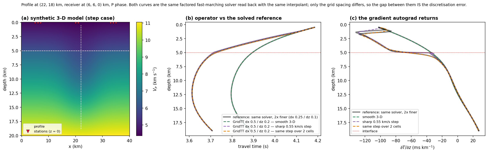

# GridTT — differentiable travel-time tables for SPIDER

Precomputed factored-eikonal tables read back with a Catmull-Rom tricubic interpolant, used in place of an
EikoNet checkpoint in [SPIDER](https://arxiv.org/abs/2508.12117). Same call signature
(`model(x[N,7]) -> T[N,1]`, autograd in the source coordinates), so nothing else in a run changes.

```
x[N,7] = (src_x, src_y, src_z, rec_x, rec_y, rec_z, phase)   km, phase 0 = P / 1 = S
T[N,1] = travel time in seconds
```

## Install

```bash
pip install -e .
```

numpy, scipy, pandas, torch, pyproj, eikonalfm. `eikonalfm` is only needed to build tables.

## 1. Build

```bash
gridtt build-spider SPIDER.json --velocity velmod.csv --out tables/run1 --dx 0.5 --dz 0.2 --jobs 8
```

Takes the stations, the event volume and the projection from `io.station_file`, `io.catalog_infile` and
`model.domain`. Writes `tables/run1/{tables.f32, meta.json}` and a copy of the config pointing at them
(`SPIDER_gridtt.json`, with `model.eikonet.model_kind = "gridtt"`).

| option | default | |
|---|---|---|
| `--velocity` | — | velocity file |
| `--velocity-format` | `auto` | `profile1d` 1-D nodes · `layers1d` 1-D layer tops · `csv` 3-D lon/lat or x/y · `ascii8` 8-column whitespace |
| `--smooth-interfaces` | 0 km | `layers1d`: ramp each layer boundary over this width |
| `--dx` | 0.5 km | map-view spacing |
| `--dz` | 0.2 km | depth spacing |
| `--z-max` | `model.domain.z_max` | table bottom |
| `--margin` | 6.0 km | padding around stations ∪ events |
| `--jobs` | 1 | parallel solves (one per station-phase) |

Velocity files are read in any of the usual conventions: lon/lat or projected x/y, depth or elevation, m or km,
m/s or km/s, Vs or Vp/Vs; column names are matched case-insensitively.

## 2. Run SPIDER with it

Without modifying SPIDER:

```bash
python -m gridtt.spider_hook locate-map SPIDER_gridtt.json --device 0
python -m gridtt.spider_hook sample     SPIDER_gridtt.json --device 0
```

Natively, after applying `spider_patch/eikonet_loader_gridtt.patch` (6 lines in `spider/core/eikonet_loader.py`):

```bash
spider locate-map SPIDER_gridtt.json --device 0
```

From Python:

```python
from gridtt import load_gridtt
model = load_gridtt("tables/run1", device="cuda:0")
```

## 3. Check the spacing

```bash
gridtt validate tables/run1 --refine 2 --stations 6 --jobs 8 --json validation.json
```

Rebuilds a spread of your stations at half the spacing and compares travel time, both gradients and a
high-frequency artefact score, all relative to the medium's slowness (|∇T| = 1/v). Exit code 0 pass, 1 fail.

| option | default | |
|---|---|---|
| `--refine` | 2 | reference built at dx/refine, dz/refine |
| `--stations` | 6 | stations tested, spread over the network |
| `--points` | 200000 | source-receiver pairs sampled |
| `--gate` | 0.01 | pass threshold, as a fraction of 1/v |
| `--velocity` | from `meta.json` | override the model |
| `--reference-dir` / `--keep-reference` | temp, deleted | keep the reference tables |
| `--jobs` | 1 | parallel solves |
| `--json` | — | write the statistics |

## Python API

```python
from gridtt import (load_gridtt, build_tables, build_for_spider, validate_tables,
                    open_velocity, Profile1D, LayerCake1D, LayeredGridVelocity, FunctionVelocity)

vel   = open_velocity("velmod.csv", proj, fmt="auto")       # any supported layout
meta  = build_tables(sta_xyz, box, vel, "tables/run1", dx=0.5, dz=0.2, n_jobs=8)
model = load_gridtt("tables/run1", device="cuda:0")         # torch.nn.Module
stats = validate_tables("tables/run1", refine=2, n_sta=6)
```

`gridtt.spider_hook.install()` rebinds `spider.cli.load_eikonet_model` from inside Python.

## How it works

| step | choice |
|---|---|
| velocity | interpolated linearly in map view per depth level, linearly in depth |
| solver | factored eikonal, 2nd-order fast marching (`eikonalfm`), T = \|x − x_sta\| · τ₁ |
| tables | one per station and phase, lattice anchored so the station is exactly a node, box = station ∪ events + margin |
| read-back | Catmull-Rom tricubic, 4×4×4 nodes, in PyTorch — interpolating and C¹ |

64 table reads per query regardless of spacing (~1.5 × 10⁷ queries/s forward+backward on one GPU). Table size
scales as (box) × stations × phases / (dx² dz).



Synthetic 3-D model (gradient, lateral low-velocity body, interface): travel time and ∂T/∂z along one profile for
the operator at dx 0.5 / dz 0.2 and for the same solver at half that spacing. Convergence order 2.18 in travel
time, 0.025 ms differential error between the two spacings, artefact 0.25 % of 1/v.

## References

Treister & Haber 2016 (JCP 324:210); Fomel, Luo & Zhao 2009 (JCP 228:6440); Keys 1981; Ross et al.,
SPIDER (arXiv:2508.12117); Smith et al., EikoNet (IEEE TGRS 2021).
